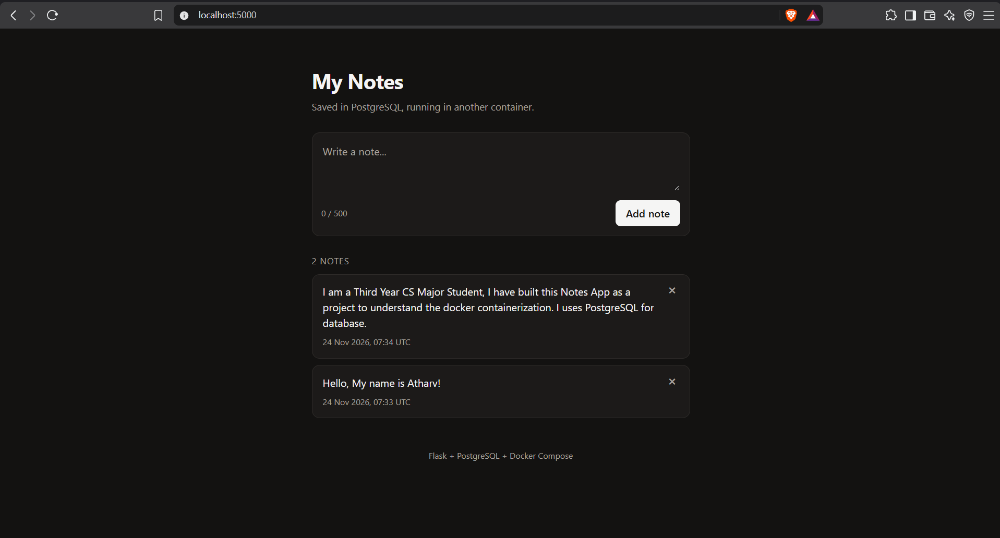

# Compose Notes App

A tiny notes app: a Flask web app and a PostgreSQL database, started together with Docker Compose.

## What I learned
- Writing a Dockerfile for a Python app
- Running two containers with Docker Compose
- Containers talking to each other by service name
- Keeping data with a named volume
- Keeping secrets in a .env file (not committed)
- Using a healthcheck so the web app waits for the database

## Run it
1. `cp .env.example .env` and set your own password
2. `docker compose up -d --build`
3. Open http://localhost:5000

## Stop it
- `docker compose down` (keeps data)
- `docker compose down -v` (deletes data too)